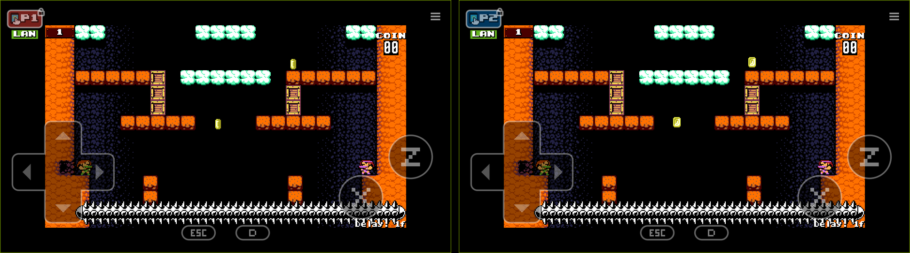
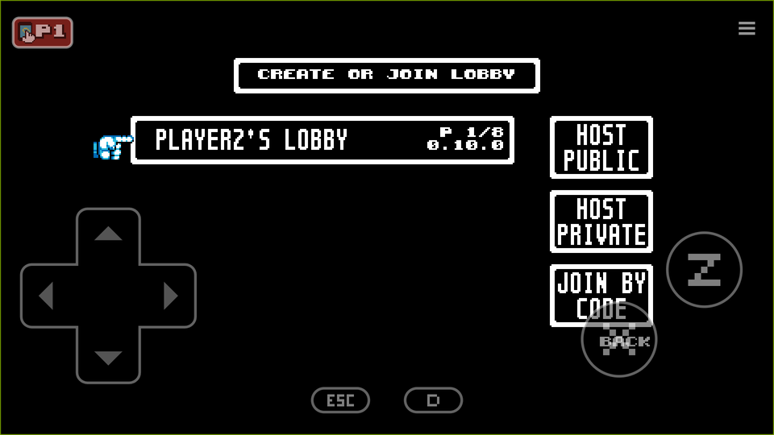
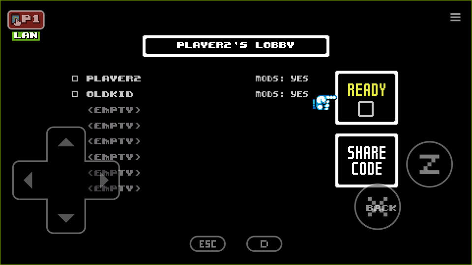
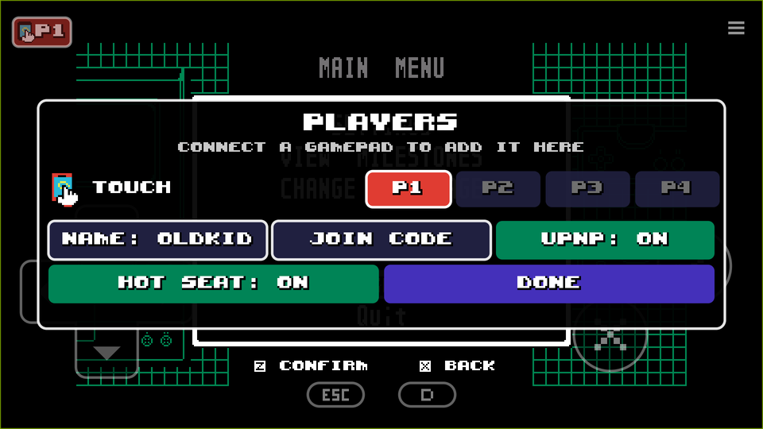
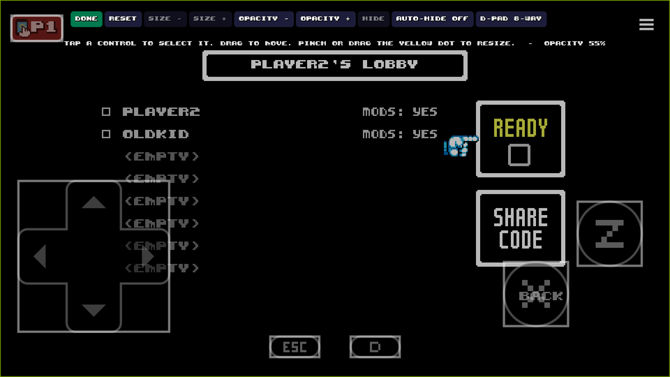
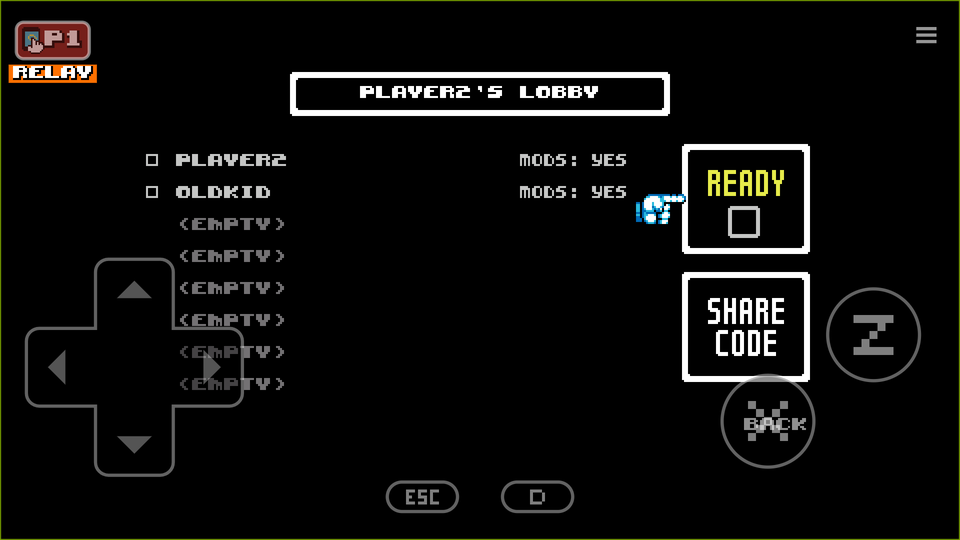

# UFO 50 Android Online: PFO 50 + MultiMadnessMod

**v0.2** · Build your own Android version of **UFO 50** from your own Steam copy. It includes
online multiplayer from **PFO 50**, 4+ players in many games from **MultiMadnessMod**, and touch
controls made for the game.


*The same co-op game on two phones, connected online (the LAN tag under each player chip).*

This repository contains no part of UFO 50. The build reads the game from your own Steam
installation, downloads the mods and tools from their authors' pages, and makes an APK only you
have. **Please don't share the APK.** UFO 50 is a paid game by a small studio. Buy it
([Steam](https://store.steampowered.com/app/1147860/UFO_50/)) and have your friends buy it too.

This is a fork of Skyline969's
[UFO50AndroidUnofficial](https://github.com/Skyline969/UFO50AndroidUnofficial), which showed that
UFO 50 runs on Android's GameMaker runner. The fork rebuilds the runner for UFO 50 1.9.5 and adds
the mods, the touch overlay and online play.

**Quick start:** install UFO 50 from Steam, download this repository
([zip](https://github.com/Patrick-Working/UFO50AndroidOnline/archive/refs/tags/v0.2.zip)), unzip
it, and double-click **`build.bat`**. See [Quick build](#quick-build).

---

## Screenshots

| | |
|---|---|
|  |  |
| **Online lobby list**: lobbies on your network and on the internet, plus HOST PUBLIC / HOST PRIVATE / JOIN BY CODE | **In the lobby**: both players, and how you're connected (here LAN) |
|  |  |
| **Players panel**: touch and each gamepad to P1-P4, your name, join code, UPnP, hot seat | **Layout editor**: move, resize and hide controls, opacity, 4-way / 8-way d-pad |

## Features

**Online multiplayer (PFO 50)**
- Play UFO 50's multiplayer games with people on other phones running this build, in PFO 50's own
  lobby. Players on the same network are found automatically, and anyone else connects over the
  internet.
- The lobby menu has **HOST PUBLIC**, **HOST PRIVATE** and **JOIN BY CODE**. A private lobby gets a
  6-character code.
  - In the lobby, **SHARE CODE** opens a box with SHARE (Android's share sheet), COPY and CLOSE.
  - The join box has PASTE, which picks the code out of a pasted message.
- Internet lobbies are listed by the [okplay](https://github.com/Patrick-Working/okplay) room
  server at [oldkid.net](https://oldkid.net). See [How online play connects](#how-online-play-connects).
- A tag under your player chip shows how you're connected:
  - **LAN** (green): same network.
  - **DIRECT** (blue): peer to peer over the internet.
  - **RELAY** (orange): through the server.

  The host's tag shows the slowest link among its players.
- You stay connected when you switch apps or the screen turns off. While you're online, a quiet
  notification ("UFO 50 - online") stops Android from freezing the game in the background.
- Your seat is locked while online. Each phone plays its own player, so nobody can take over a
  remote player's controls.
- Set your **player name** in the players panel (NAME).

**Local multiplayer (MultiMadnessMod + the players panel)**
- Up to 4+ players in many games, on one phone, with touch and Bluetooth or USB gamepads.
- **Players panel**: tap your player chip (top left), or use the game's own *Settings > Joypad
  Config > Pad Assign*. Bind the touch controls and each connected gamepad to P1-P4 or OFF. Each pad
  gets a numbered badge.
- **Hot seat**: in turn-based games, the touch controls follow whoever's turn it is. This covers
  Party House, Bug Hunter, Mortol II, Lords of Diskonia, Avianos, Hot Foot and Grimstone. A yellow
  **HS** block marks the active player and blinks when the turn changes.

**Touch controls**
- A classic d-pad (8-way by default, with a 4-way switch), the two action buttons, MENU and BACK.
- Buttons carry the labels the game itself shows: the keys it has bound (Z / X, or DEL / END on
  player 2's side of the keyboard). They follow your rebinds and use UFO 50's own font and colours.
- The layout editor (the ☰ button, top right) lets you move, resize and hide controls and change
  their opacity.
- *Settings > Video Settings > Scale* works. 4x leaves room beside the picture for the controls,
  and FILL fills the screen.

**Other fixes**
- Quit in the main menu closes the app.
- Runs on arm64 phones and on x86_64 emulators (BlueStacks, Android Studio's emulator).

## How online play connects

The game finds the fastest way to reach the other players, in this order:

1. **Same network (LAN)**: found by broadcast, with no server involved.
2. **Direct (peer to peer)**: the host's lobby is listed on the okplay room server along with its
   addresses. When you join, both phones send to each other at once (hole punching). That gets
   through almost every home router and phone carrier.
3. **UPnP**: a host asks its router to open the game's port, if the router allows it. You can turn
   this off in the players panel (UPNP).
4. **Relay**: if nothing direct gets through within 2.5 seconds, the game falls back to the okplay
   relay on oldkid.net.

**The relay is slower.** Every packet goes through the server, which adds about 0.1-0.2 s each
way. That's fine for lobbies and turn-based games but noticeable in action games. PFO 50 raises
its input delay to compensate: from 6 frames to about 12 in our tests.

In most conditions you'll be **direct**. The relay is for awkward networks (double NAT, strict
firewalls, some emulators). If you see RELAY at home, turning on UPnP on the host's router usually
gets you DIRECT.



The room server matches players and relays packets when it has to. It holds only the open lobbies
(name, player count, addresses), and each one disappears when its lobby closes.

The netcode lives in okplay's [`oknative/`](https://github.com/Patrick-Working/okplay/tree/main/oknative)
folder, so other games can use it too.

## Quick build

You need **Windows 10 or 11** and **UFO 50 1.9.5 from Steam**. Nothing else to install.

1. Download this repository
   ([zip](https://github.com/Patrick-Working/UFO50AndroidOnline/archive/refs/tags/v0.2.zip)) and
   unzip it anywhere.
2. Double-click **`build.bat`**. It finds UFO 50 in your Steam library and checks the version, then
   downloads the tools and mods into `work\`, each checked against a fixed checksum.
3. **The first time**, the UFO 50 Mod Loader opens with both mods in place. Click **Install**, wait
   until it's done, and close it. It makes a modded copy of the game and leaves your Steam
   installation alone. (The Mod Loader's own headless mode doesn't work yet in 2.3.0, hence the
   click.)
4. A few minutes later you get **`work\ufo50-online.apk`**.

Copy the APK to the phone and open it. You may need to allow your file manager to install apps.
If you get "package appears to be invalid", the copy was cut short: copy it again and check it is
the same size on both ends.

With the phone connected over USB and USB debugging on, `build.bat -Install` installs it directly
(this needs adb). If UFO 50 isn't found, run `build.bat -GamePath "D:\path\to\UFO 50"`.

The APK is signed with a key made for you on the first build (`work\keys\`). Keep that folder:
Android only installs an update over an existing install when it's signed with the same key.

**What the quick build does:** it patches the modded game for Android
(`scripts/android_patch.csx`: hot seat, pad bindings, the lobby menu, Quit). It takes the
overlay's font and button icons from your copy of the game (`scripts/export_overlay_art.csx`).
Then it packs the game into the **runner kit** and signs the result (`scripts/pack_apk.csx`).

The runner kit (`kit/ufo50-online-runner-v0.2.apk`) is the part that's the same for everyone:
GameMaker's Android runner with the touch overlay, the online service and PFO 50's netcode, and no
game data. The full build makes it from source.

## Full build

For changing the overlay or the netcode: this builds the runner kit's contents from source, then
does the quick build with it. It runs in Git Bash and needs:

| what | where | notes |
|---|---|---|
| **Git for Windows** | <https://git-scm.com> | Git Bash |
| **JDK 21** (or 17) | `winget install EclipseAdoptium.Temurin.21.JDK` | for GameMaker's Android build |
| **Android SDK** | [Android Studio](https://developer.android.com/studio) or the [command-line tools](https://developer.android.com/studio#command-line-tools-only) | build-tools 35.0.0, platform android-35, NDK 27.2.12479018. With the command-line tools installed, `build.sh` installs the rest after you accept Google's licences. |
| **GameMaker** | <https://gamemaker.io> (free account) | Sign in once, and install runtime **2024.14.1.253** with the Android module (*File > Preferences > Runtime Feeds*). |

```bash
bash build.sh --check     # is everything found?
bash build.sh             # build the runner from source, then the APK
bash build.sh --kit       # build only the runner kit (work/kit/), the file the quick build uses
```

Paths it can't find go in `local.env` (copy `local.env.example`). The full build fetches the
[PFO 50 source](https://github.com/Blaizer/PFO-50), [ENet](https://github.com/lsalzman/enet) and
okplay's netcode, all at pinned versions. It builds `libPFO.so` with the NDK and the runner
(`android/gm-project`) with GameMaker's Igor, using your GameMaker account the same way the IDE
does when you export a game.

`scripts/make_icon.py` redraws the app icon (Python 3 + Pillow); you only need it to change the
icon.

## Versions

This release (**v0.2**) is made for exactly these versions. The patches are written against them,
and the build checks the checksums.

| part | version | from |
|---|---|---|
| UFO 50 | **1.9.5** (Steam) | [Mossmouth](https://50games.fun) |
| PFO 50 | **0.10.0** | [GameBanana](https://gamebanana.com/mods/648717), source [Blaizer/PFO-50](https://github.com/Blaizer/PFO-50) @ `b8c9327` |
| MultiMadnessMod | **1.30** | [GameBanana](https://gamebanana.com/mods/605308) |
| UFO 50 Mod Loader | **2.3.0** (portable) | [phil-macrocheira/UFO-50-MOD-LOADER](https://github.com/phil-macrocheira/UFO-50-MOD-LOADER) |
| UndertaleModTool CLI | **0.9.2.0** | [UnderminersTeam/UndertaleModTool](https://github.com/UnderminersTeam/UndertaleModTool) |
| GameMaker runtime | **2024.14.1.253** (VM, Android) | [YoYo Games](https://gamemaker.io) |
| ENet | **1.3.18** + okplay's relay hooks | [lsalzman/enet](https://github.com/lsalzman/enet) |
| okplay oknative | `d536388` | [Patrick-Working/okplay](https://github.com/Patrick-Working/okplay/tree/main/oknative) |
| Android NDK / build-tools / platform | 27.2.12479018 / 35.0.0 / android-35 (full build only) | Google |
| App | package `com.unofficial.ufo50`, minimum Android 7.0 (API 24), target API 35 | |

The okplay room server is `https://oldkid.net/aoe2net/okplay.php`. UFO 50 lobbies use their own
app id and wire number there, so they never mix with other okplay games.

## Playing

- **First start**: go to *Settings > Video Settings > Scale*. 4x leaves room for the controls, and
  FILL fills the screen.
- **Move the controls**: ☰ (top right) opens the layout editor. Drag a control to move it, and
  pinch it or drag its yellow dot to resize it. The 4-way / 8-way d-pad switch is there too. DONE
  saves.
- **Gamepads**: connect them, then tap your player chip to open the players panel and give each
  pad a player.
- **Hot seat**: tap the player chip and turn HOT SEAT on, then pass the phone around.
- **Online**: choose *Online* from the main menu.
  - HOST PUBLIC to be listed, HOST PRIVATE to get a code, JOIN BY CODE to enter one.
  - Everyone needs this same build, with the same game version and the same mods.
- **Names**: players panel > NAME. Change it while you're not in a lobby.

## Troubleshooting

- **The lobby list doesn't show my friend's game.** Give the search a few seconds; internet rooms
  can take a moment on mobile data. Check that you both have the same build. A private lobby only
  shows up with its code.
- **"Timed out attempting to join lobby".** Try again once. If it keeps happening, the host can
  turn on UPnP on their router. The relay should still connect you, just more slowly.
- **Disconnected after switching apps.** Allow the app's notification (Android 13 and later ask).
  Without it Android may freeze the game in the background.
- **"App not installed" when updating.** The new APK was signed with a different key (a different
  `work\keys` folder). Uninstall the old one first, which deletes its saves, or build with the old
  `work\keys` folder.
- **Build errors.** The quick build prints the failing step. For the full build, run
  `bash build.sh --check`; Igor's log is `work/gm/igor.log`.

**Testing switches** (for developers), as files in
`/sdcard/Android/data/com.unofficial.ufo50/files/`:
- An empty file named `forcerelay` makes that phone join through the relay only.
- An `okplay.txt` file holding a URL points the game at another room server. okplay's
  `rdv_standin.py` runs one locally.

## What's in this repository

| path | what |
|---|---|
| `build.bat`, `build.ps1` | the quick build |
| `build.sh` | the full build |
| `kit/` | the runner kit the quick build uses (made by `build.sh --kit`; no game data) |
| `android/gm-project/` | the GameMaker runner project: the PFO extension with the touch overlay (`PFO_Android.java`), the online service, and the app icon (original art) |
| `pfo/` | the Android port of PFO 50: a patch to its `dllmain.cpp`, plus the Android layer in `android/` (Steam lobbies and networking over ENet, the bridge to the GameMaker runner, the hot seat and pad builtins) |
| `scripts/` | the game patch, the overlay art export, the APK packer and signer (UndertaleModTool scripts), and the native build |
| `docs/screenshots/` | the pictures on this page |

Nothing from the game is stored here: no game files, art or music. The only game code is the short
snippets the patch script searches for in order to patch them. The screenshots show the game
running.

## Credits

- **UFO 50** by [Mossmouth](https://50games.fun). Please buy it.
- **[PFO 50](https://github.com/Blaizer/PFO-50)** by Blaizer
  ([GameBanana](https://gamebanana.com/mods/648717)), MIT licence: the online multiplayer all of
  this is built on.
- **[MultiMadnessMod](https://gamebanana.com/mods/605308)** by Jonesey13: 4+ players in many games.
- **[UFO50AndroidUnofficial](https://github.com/Skyline969/UFO50AndroidUnofficial)** by Skyline969:
  the original Android build this repository is forked from.
- **[UFO 50 Mod Loader](https://github.com/phil-macrocheira/UFO-50-MOD-LOADER)** by Phil
  Macrocheira, MIT licence: applies the mods.
- **[UndertaleModTool](https://github.com/UnderminersTeam/UndertaleModTool)** by the Underminers
  team, GPL-3.0: reads and patches the game data, and runs the build's scripts.
- **[ENet](https://github.com/lsalzman/enet)** by Lee Salzman, MIT licence: the network transport.
- **[okplay](https://github.com/Patrick-Working/okplay)** and the [oldkid.net](https://oldkid.net)
  room server: the lobby list, hole punching, UPnP and the relay.
- **GameMaker** by YoYo Games: the Android runner.
- Public STUN servers from Cloudflare and Google.

## Licence

The code in this repository is MIT licensed (see `LICENSE`). The tools and mods it downloads keep
their own licences. UFO 50 is © Mossmouth.
