# UFO 50 Android Online: PFO 50 + MultiMadnessMod

**v0.4.1** · Build your own Android version of **UFO 50** from your own Steam copy. It includes
online multiplayer from **PFO 50**, 4+ players in many games from **MultiMadnessMod**, touch
controls made for the game, and **save states**, in single player and online. Since v0.4.0 the same
build also makes a **Windows version** that plays online with the phones.

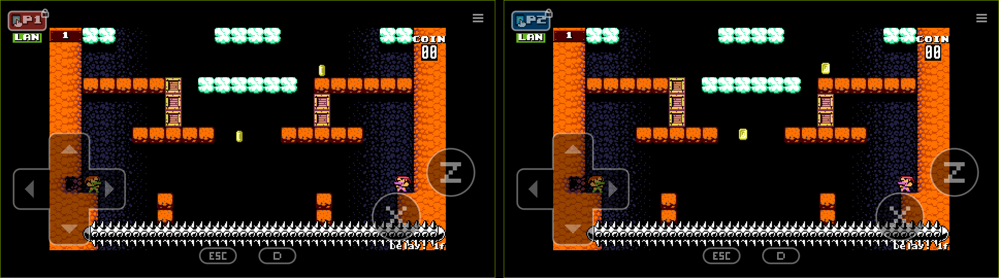
*The same co-op game on two phones, connected online. The picture is from v0.2, which showed the
connection (here LAN) as a tag under each player chip. Since v0.3 the session pill after the chips
says how you're connected.*

This repository contains no part of UFO 50. The build reads the game from your own Steam
installation, downloads the mods and tools from their authors' pages, and makes an APK only you
have. **Please don't share the APK.** UFO 50 is a paid game by a small studio. Buy it
([Steam](https://store.steampowered.com/app/1147860/UFO_50/)) and have your friends buy it too.

This is a fork of Skyline969's
[UFO50AndroidUnofficial](https://github.com/Skyline969/UFO50AndroidUnofficial), which showed that
UFO 50 runs on Android's GameMaker runner. The fork rebuilds the runner for UFO 50 1.9.5 and adds
the mods, the touch overlay and online play.

> **An early release.** So far it has only been tested on emulators (BlueStacks) and on one
> Windows 10 PC: not yet on a real phone, with a real controller on Windows, on a second PC, or
> with more than two players online. Expect rough edges, and please
> [open an issue](https://github.com/Patrick-Working/UFO50AndroidOnline/issues) with what you
> find, good or bad. What was tested and what wasn't: [docs/TESTING.md](docs/TESTING.md).

**Quick start:** install UFO 50 from Steam, download this repository
([zip](https://github.com/Patrick-Working/UFO50AndroidOnline/archive/refs/tags/v0.4.1.zip)), unzip
it, and double-click **`build-android.bat`** for the APK or **`build-windows.bat`** for the Windows
version. See [Quick build](#quick-build).

## What's new in v0.4.0

- **A Windows version.** `build-windows.bat` makes a second game folder beside your Steam
  installation: UFO 50 with this build's online play, save states and rewind, for a PC. It joins the
  same lobbies as the phones (your network, oldkid.net rooms, the relay) with the same invite codes
  and online saves. It never talks to Steam and keeps its own saves, so your Steam game and its
  saves are left alone. See [Windows version](#windows-version).
- **A menu for keyboard and controller on Windows.** **F1**, or both sticks pressed in, opens what
  the touch overlay is on a phone: your seat and connection, the invite code, SAVE, the list of
  saves with their pictures, rewind, auto save, your name. A load another player asks for shows in
  a box with the save's picture (**F2** accepts, **F3** declines).
- **Save states work the same on Windows**: a save loads in about a second, and an accepted load
  in a match puts every device, phone or PC, back on the same frame.
- **Everyone in a lobby needs the same version.** v0.4.0 and earlier versions can't join each
  other's lobbies any more (a match between them would go out of step), so update every device.
- **Online fixes.** A dropped player who has no player in the current game (a third player watching
  a 2-player game) is waited for like anyone else, instead of being left behind for good.
  Reconnecting after loading a save from another match no longer stalls for half a minute over the
  relay. A load that restarts the match starts on every device as soon as one device starts it, so
  none is left in the old match. Loading a library save from inside a game no longer stops the host
  with an error.
- **Overlay fixes.** A tap that closes a box no longer presses the control under it; a vote takes
  your first answer; seats P5 to P8 have colours.
- Many smaller fixes from a review of the whole code: see [CHANGELOG.md](CHANGELOG.md).

## What's new in v0.3.1

- **Load and rewind times you can trust.** Estimates now know how fast this device replays each
  game (some replay over twice as fast as others), so a long rewind no longer takes much longer
  than it said: in tests they're within 10%, leaning long. The loading screen shows the time left.
- The ask-first box fits its contents, and REWINDING shows once.

## What's new in v0.3

- **Save states.** Save anywhere in any of the 50 games and load it back in about a second. Tap
  the disk icon (top right) for the save list: SAVE NOW, pick a save to see its picture and
  details, LOAD or DELETE. Tick **AUTO SAVE WHEN I PAUSE** to have pausing save into one AUTO slot.
  See [Save states](#save-states).
- **Rewind.** REWIND 15 S / 30 S / 60 S in the save list takes you back that far, to the exact
  frame. Each button shows how long it will take; anything 5 seconds or more asks first. It
  doesn't add stutters to play: it starts from your saves and from snapshots taken only while the
  game is paused or just starting, and replays your inputs from there.
- **Save states online.** SAVE NOW in an online match saves for everyone at the same moment.
  LOAD asks the other players first ("P1 WANTS TO LOAD", ACCEPT / DECLINE), and everyone loads
  together. Saves from earlier matches load too, if they had the same number of players.
- **Drops don't end the match.** If a player's connection drops, everyone waits up to 90 seconds
  ("WAITING FOR P2 - 1:26") and play resumes when they're back. If their app was closed or crashed,
  they reopen it and tap **REJOIN**: their phone catches up on the match in a couple of seconds.
  This works over the relay too.
- **A tidier overlay.** One chip per player (touch and gamepad icons inside it), a session pill
  that says how you're connected (SOLO: SAVES ON, ONLINE: LAN 2F, CATCHING UP...) and then
  settles to a dot, short banners, and online players' names on a tap. In the layout editor,
  **CHIPS ROW / COLUMN** stacks the chips vertically.
- **A crash fixed.** About one load in forty, and now and then opening a game, could crash the app
  (GameMaker's audio decoding read the game thread's state). Fixed; 40 of 40 test loads ran clean.
- Fixes: even line weight in the disk icon, nothing pokes out from under the save list, and the
  orange warning banners use white text.

The full list is in [CHANGELOG.md](CHANGELOG.md). How save states, rewind and rejoining work:
[docs/SAVE_STATES.md](docs/SAVE_STATES.md). How it was tested, and what hasn't been:
[docs/TESTING.md](docs/TESTING.md).

---

## Screenshots

| | |
|---|---|
| 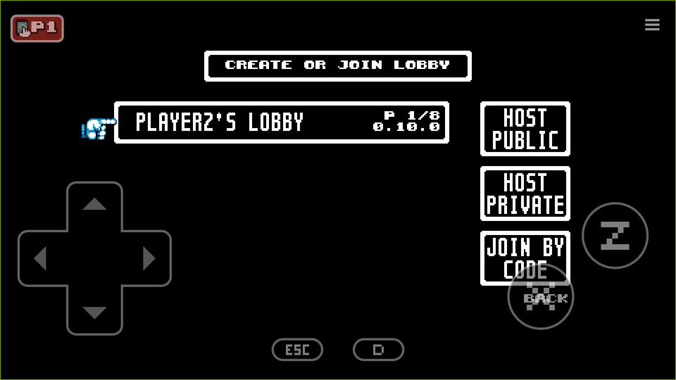 | 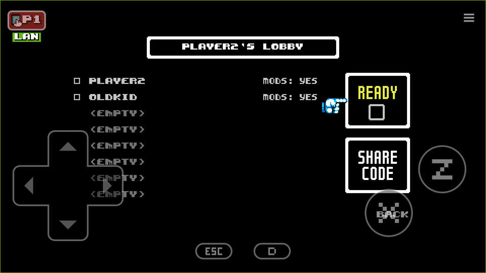 |
| **Online lobby list**: lobbies on your network and on the internet, plus HOST PUBLIC / HOST PRIVATE / JOIN BY CODE | **In the lobby**: both players are listed |
| 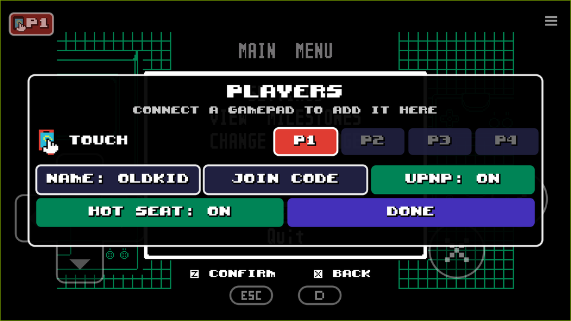 | 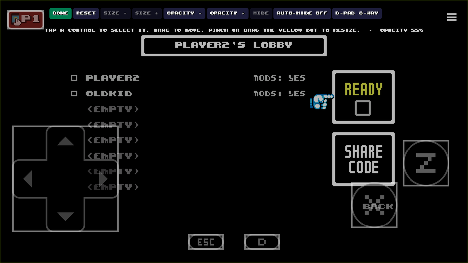 |
| **Players panel**: touch and each gamepad to P1-P4, your name, join code, UPnP, hot seat | **Layout editor**: move, resize and hide controls, opacity, 4-way / 8-way d-pad |
| 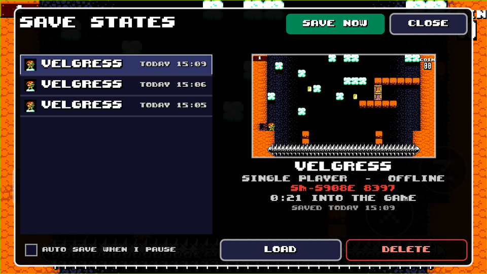 | 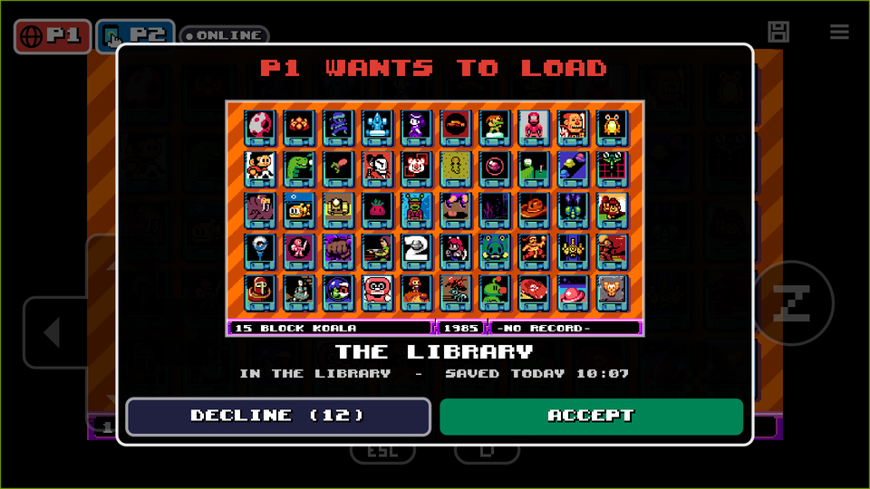 |
| **Save states**: the save list with each save's picture, game, players and time into the game, and the REWIND buttons with how long each takes | **Loading online**: the other players see what you want to load and accept or decline |
| 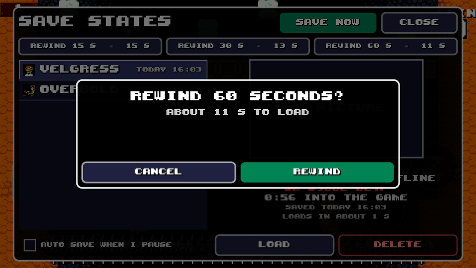 | 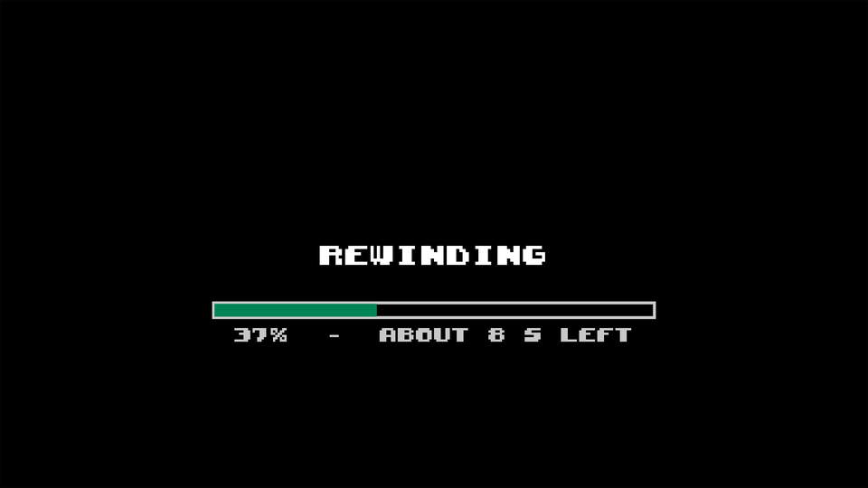 |
| **Rewind**: a rewind that will take 5 seconds or more asks first, with the estimate | **Rewinding**: your inputs replay at high speed to the exact frame, with the time left |
| 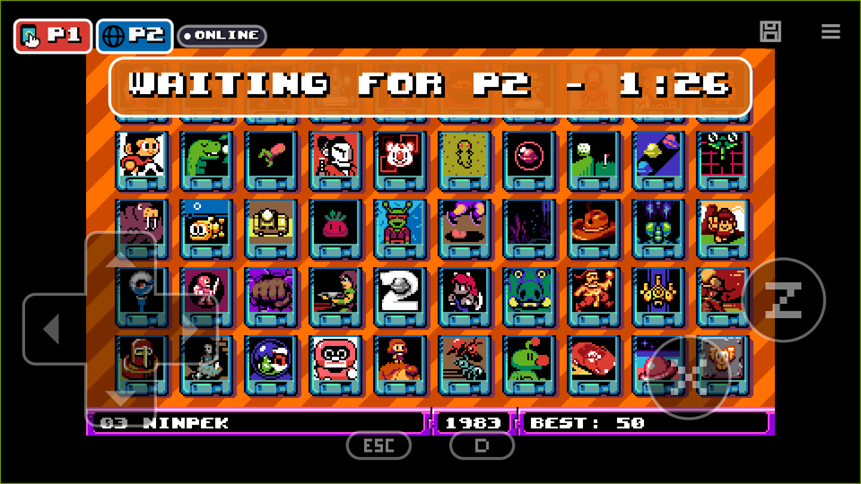 | 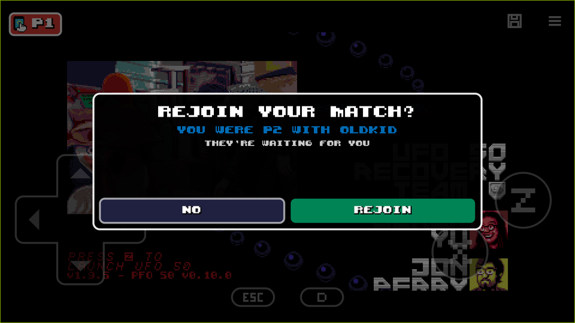 |
| **A dropped player**: everyone waits, with a countdown, until they're back | **Rejoining**: reopen the app and tap REJOIN to catch up with the match |
| 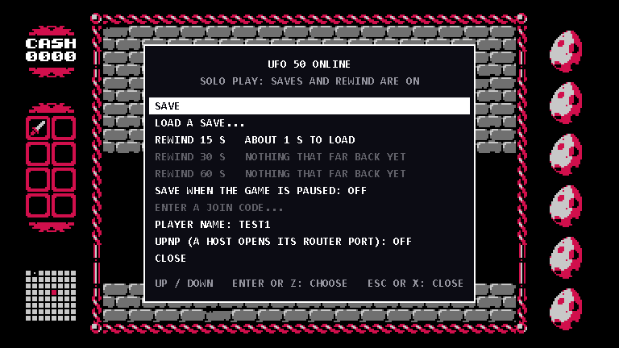 | 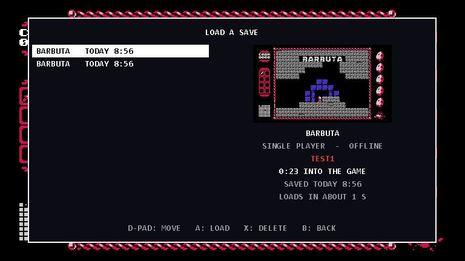 |
| **Windows: the menu** (F1, or both sticks pressed in), for keyboard and controller | **Windows: the list of saves**, with the chosen save's picture and how long it takes to load |

The first four pictures (lobby list, lobby, players panel, layout editor) are from v0.2. The overlay
has changed since: the connection (LAN, DIRECT or RELAY) is no longer a tag under the player chip,
it shows in the session pill after the chips. See *Overlay* in [CHANGELOG.md](CHANGELOG.md).

## Features

**Online multiplayer (PFO 50)**
- Play UFO 50's multiplayer games with people on other phones running this build (or PCs running
  its [Windows version](#windows-version)), in PFO 50's own lobby. Players on the same network are
  found automatically, and anyone else connects over the internet.
- The lobby menu has **HOST PUBLIC**, **HOST PRIVATE** and **JOIN BY CODE**. A private lobby gets a
  6-character code.
  - In the lobby, **SHARE CODE** opens a box with SHARE (Android's share sheet), COPY and CLOSE.
  - The join box has PASTE, which picks the code out of a pasted message.
- Internet lobbies are listed by the [okplay](https://github.com/Patrick-Working/okplay) room
  server at [oldkid.net](https://oldkid.net). See [How online play connects](#how-online-play-connects).
- The pill next to the player chips says how you're connected when it changes, then settles to a
  dot: **LAN** (same network), **DIRECT** (peer to peer over the internet) or **RELAY** (through
  the server), with the input delay in frames. Tap it to see it again. **CATCHING UP** (orange)
  means your phone is behind and running faster to catch up.
- Each player has a chip in their colour: yours shows your input (touch, a gamepad), the others a
  globe. Their names show when the match starts and when you tap the chips.
- You stay connected when you switch apps or the screen turns off. While you're online, a quiet
  notification ("UFO 50 - online") stops Android from freezing the game in the background.
- Your seat is locked while online. Each phone plays its own player, so nobody can take over a
  remote player's controls.
- Set your **player name** in the players panel (NAME).

**Local multiplayer (MultiMadnessMod + the players panel)**
- Up to 4+ players in many games, on one phone, with touch and Bluetooth or USB gamepads.
- **Players panel**: tap your player chip (top left), or use the game's own *Settings > Joypad
  Config > Pad Assign*. Bind the touch controls and each connected gamepad to P1-P4 or OFF. Each pad
  gets a numbered badge.
- **Hot seat**: in turn-based games, the touch controls follow whoever's turn it is. This covers
  Party House, Bug Hunter, Mortol II, Lords of Diskonia, Avianos, Hot Foot and Grimstone. Every
  player has a chip; the one whose turn it is is solid, and it pulses when the turn changes.

**Touch controls**
- A classic d-pad (8-way by default, with a 4-way switch), the two action buttons, MENU and BACK.
- Buttons carry the labels the game itself shows: the keys it has bound (Z / X, or DEL / END on
  player 2's side of the keyboard). They follow your rebinds and use UFO 50's own font and colours.
- The layout editor (the ☰ button, top right) lets you move, resize and hide controls and change
  their opacity, and stack the player chips in a column (CHIPS ROW / COLUMN).
- *Settings > Video Settings > Scale* works. 4x leaves room beside the picture for the controls,
  and FILL fills the screen.

<a id="save-states"></a>
**Save states**
- The disk icon (top right) opens the save list. **SAVE NOW** saves; each save keeps a picture,
  the game, who was playing and how far into the game. Saves are kept until you delete them.
- In single player, saving needs a recorded session: tap **START SOLO PLAY** in the save list once
  (it starts you in the library). The pill then says SOLO: SAVES ON.
- **Quick save and quick load**: the two buttons left of the disk (an arrow down into a tray, an
  arrow up out of it) save into one QUICK slot, replaced each time, and load it, in one tap. On
  Windows: **F5** and **F9**. They work in solo play; in an online match, use SAVE NOW and LOAD.
- **Loading** takes about a second for a save made since the app started: the game puts its state
  back and checks the next two seconds of play against what was recorded. Older saves (after the
  app restarted) replay the session at high speed instead, a few seconds per minute of play. Either
  way the result is checked against PFO's own checksums.
- **AUTO SAVE WHEN I PAUSE** (in the save list) saves into one AUTO slot each time you pause,
  replacing the last one. Its picture is from just before the pause.
- Every game works: all 50 were tested loading in the same room, from the library and from inside
  another game.
- **Rewind** (single player): **REWIND 15 S / 30 S / 60 S** in the save list go back that far, to
  the exact frame, and play carries on from there. Each shows how long it will take, measured on
  your device; if it's 5 seconds or more you're asked first ("REWIND 60 SECONDS? ABOUT 40 S TO
  LOAD"), and LOAD does the same for a save that has to replay. A rewind starts from the newest
  snapshot before that point (your saves, auto saves, and snapshots the game takes while it's
  paused or a game is just starting) and replays your inputs from there, so play never stutters
  for it.
- How it all works: [docs/SAVE_STATES.md](docs/SAVE_STATES.md).

**Save states online**
- **SAVE NOW** in an online match saves on every phone at the same frame, so everyone gets the save
  (the save carries a command in the game's input, like PFO 50's own commands).
- **LOAD** asks the others: they see the save's picture and details and have 15 seconds to
  ACCEPT or DECLINE. When everyone with a seat accepts, every phone loads it at the same frame and
  the match carries on from there. A decline, or no answer, cancels it for everyone.
- Saves from an earlier match load too, if it had the same number of players: your phone sends the
  save to the others first, and everyone restarts the match from it.
- In a match with a player whose device has no snapshots (a Windows game with another `ufo50.exe`
  than the build was made for) every load works that way: everyone replays the match from the save
  and connects again. It takes a few seconds per minute of the save's match instead of about one
  second.
- Players watching without a seat can't save or vote.

**Drops and rejoining**
- When a player's connection drops, the match freezes for everyone with an orange banner:
  **WAITING FOR P2 - 1:26**. The phones keep trying to reconnect, and when they do, play carries on
  where it stopped (**P2 IS BACK**). After 90 seconds the match ends as before.
- That goes for a player who has no player in the current game too (the third player in a 2-player
  game). If they aren't back after 90 seconds, the match carries on without them.
- If a player's app was closed or crashed, reopening it offers **REJOIN YOUR MATCH?**. REJOIN
  takes their old place: another player sends the match so far, their phone replays it in a couple
  of seconds and joins back in. It works over the relay too.
- With three or more players, the ones left share the dropped player's last inputs so they all wait
  at the same point. (Rejoining has been tested with two players.)

**Other fixes**
- Quit in the main menu closes the app.
- A crash in GameMaker's audio decoding (now and then when loading or opening a game) is fixed.
- Runs on arm64 phones and on x86_64 emulators (BlueStacks, Android Studio's emulator).

## How online play connects

The game finds the fastest way to reach the other players, in this order:

1. **Same network (LAN)**: found by broadcast, with no server involved.
2. **Direct (peer to peer)**: the host's lobby is listed on the okplay room server along with its
   addresses. When you join, both phones send to each other at once (hole punching). That gets
   through almost every home router and phone carrier.
3. **UPnP**: a host asks its router to open the game's port, if the router allows it. You can turn
   this off in the players panel (UPNP).
4. **Relay**: if nothing direct gets through within 2.5 seconds, the game falls back to the okplay
   relay on oldkid.net.

**The relay is slower.** Every packet goes through the server, which adds about 0.1-0.2 s each
way. That's fine for lobbies and turn-based games but noticeable in action games. PFO 50 raises
its input delay to compensate: from 6 frames to about 12 in our tests.

In most conditions you'll be **direct**. The relay is for awkward networks (double NAT, strict
firewalls, some emulators). If you see RELAY at home, turning on UPnP on the host's router usually
gets you DIRECT.

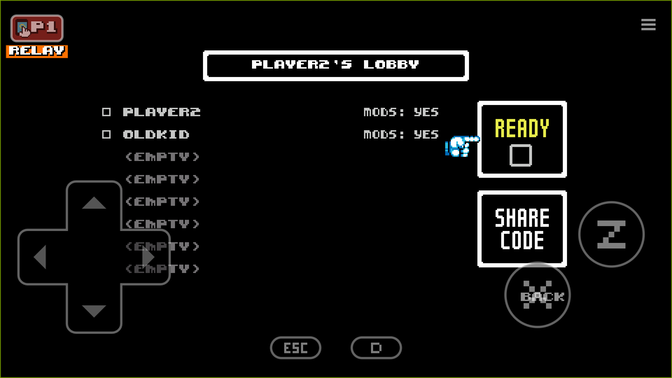

The room server matches players and relays packets when it has to. It holds only the open lobbies
(name, player count, addresses), and each one disappears when its lobby closes.

The netcode lives in okplay's [`oknative/`](https://github.com/Patrick-Working/okplay/tree/main/oknative)
folder, so other games can use it too.

## Quick build

You need **Windows 10 or 11** and **UFO 50 1.9.5 from Steam**. Nothing else to install.

1. Download this repository
   ([zip](https://github.com/Patrick-Working/UFO50AndroidOnline/archive/refs/tags/v0.4.1.zip)) and
   unzip it anywhere.
2. Double-click **`build-android.bat`** (or `build.bat`, which is the same). It finds UFO 50 in your Steam library and checks the version, then
   downloads the tools and mods into `work\`, each checked against a fixed checksum.
3. **The first time**, the build runs the UFO 50 Mod Loader without a window to install both mods
   (a minute or two). It makes a modded copy of the game and leaves your Steam installation alone.
   If that doesn't work on your PC, the Mod Loader's window opens instead with both mods in place:
   click **Install**, wait until it says it's done, and only then close it. (`-ManualLoader` goes
   straight to the window. The Mod Loader's headless mode has a bug in 2.3.0; the build works
   around it with a small startup hook it compiles on your PC, and runs the loader as downloaded.)
4. A few minutes later you get **`work\ufo50-online.apk`**.

Copy the APK to the phone and open it. You may need to allow your file manager to install apps.
If you get "package appears to be invalid", the copy was cut short: copy it again and check it is
the same size on both ends.

With the phone connected over USB and USB debugging on, `build.bat -Install` installs it directly
(this needs adb). If UFO 50 isn't found, run `build.bat -GamePath "D:\path\to\UFO 50"`.

The APK is signed with a key made for you on the first build (`work\keys\`). Keep that folder:
Android only installs an update over an existing install when it's signed with the same key.

**The plain game:** `build.bat -Vanilla` makes `work\ufo50-vanilla.apk`, your copy of the game as
Steam has it on the Android runner and nothing else: no mods, no online play, no save states and
no touch controls, so it needs a controller or a keyboard. Nothing is patched and no mods are
downloaded. It is the same app as the online build, signed with the same key: installing one
replaces the other and keeps the saves. (The game still asks Steam for things every frame and the
runner notes each one in the Android log; that is harmless.)
`build.bat -Vanilla -Windows` makes `work\windows\UFO 50 Vanilla`, a portable copy of the plain game
that doesn't need Steam: no game file is changed, Steam's libraries are left out. Start
`UFO 50 Portable.bat` in it and the saves stay inside the folder (`saves\`), so the whole folder can
be moved to another PC. (Starting `ufo50.exe` itself uses the PC's save folder, the Steam game's.)

**What the quick build does:** it patches the modded game for Android
(`scripts/android_patch.csx`: hot seat, pad bindings, the lobby menu, Quit). It takes the
overlay's font and button icons from your copy of the game (`scripts/export_overlay_art.csx`).
Then it packs the game into the **runner kit** and signs the result (`scripts/pack_apk.csx`).

The runner kit (`kit/ufo50-online-runner-v0.4.0.apk`) is the part that's the same for everyone:
GameMaker's Android runner with the touch overlay, the online service and PFO 50's netcode, and no
game data. The full build makes it from source.

## Full build

For changing the overlay or the netcode: this builds the runner kit's contents from source, then
does the quick build with it. It runs in Git Bash and needs:

| what | where | notes |
|---|---|---|
| **Git for Windows** | <https://git-scm.com> | Git Bash |
| **JDK 21** (or 17) | `winget install EclipseAdoptium.Temurin.21.JDK` | for GameMaker's Android build |
| **Android SDK** | [Android Studio](https://developer.android.com/studio) or the [command-line tools](https://developer.android.com/studio#command-line-tools-only) | build-tools 35.0.0, platform android-35, NDK 27.2.12479018. With the command-line tools installed, `build.sh` installs the rest after you accept Google's licences. |
| **GameMaker** | <https://gamemaker.io> (free account) | Sign in once, and install runtime **2024.14.1.253** with the Android module (*File > Preferences > Runtime Feeds*). |

```bash
bash build.sh --check     # is everything found?
bash build.sh             # build the runner from source, then the APK
bash build.sh --kit       # build only the runner kit, into work/kit/
```

The quick build does not look in `work/kit/`. It uses the kit in `kit/`, and downloads that file
from the version's tag if the one in `kit/` is missing or has another checksum. To make the quick
build use a kit you built: copy it to `kit/` and put its SHA-256 (`build.sh --kit` prints it) in the
`Kit` line of `build.ps1`.

Paths it can't find go in `local.env` (copy `local.env.example`). The full build fetches the
[PFO 50 source](https://github.com/Blaizer/PFO-50), [ENet](https://github.com/lsalzman/enet) and
okplay's netcode, all at pinned versions. It builds `libPFO.so` with the NDK and the runner
(`android/gm-project`) with GameMaker's Igor, using your GameMaker account the same way the IDE
does when you export a game.

`scripts/make_icon.py` redraws the app icon into `android/gm-project/icons/` (Python 3 + Pillow;
`--preview` also writes `work/icon_preview.png`). You only need it to change the icon.

<a id="windows-version"></a>
## Windows version

Double-click **`build-windows.bat`** (or run `build.bat -Windows`). It makes
`work\windows\UFO 50 Online`: your modded copy of the game with this build's netcode
(`PFO.dll`) in place of PFO 50's Steam networking. The first run installs the mods with the UFO 50 Mod Loader, as in
step 3 of the [quick build](#quick-build). Start `ufo50.exe` in that folder.

- It plays with the phones and with other PCs running it: HOST PUBLIC, HOST PRIVATE, JOIN BY CODE
  and the lobby list work as on Android.
- **It never talks to Steam**: there is no Steam library in the folder, Steam doesn't need to be
  running, and it can't join PFO 50 lobbies on Steam. It keeps its own saves in
  `%LOCALAPPDATA%\ufo50_online`; the Steam game's saves (`%LOCALAPPDATA%\ufo50`) are never read or
  written.
- **F1**, or **both sticks pressed in** on a controller, opens its menu: what the touch overlay
  does on a phone, made for a keyboard and a controller (seat and connection, invite code, SAVE,
  the list of saves with their pictures, START SOLO PLAY and REWIND, auto save, name, UPnP). A load
  another player asks for shows in a box with the save's picture: **F2** accepts, **F3** declines.
  **F5** quick saves and **F9** quick loads (solo play).
- **Saves load from snapshots as on the phones** (about a second; in a match, on every device
  within a few frames). They are made for the `ufo50.exe` of UFO 50 1.9.5: with another one the
  game turns them off, replays instead (about 4 seconds per minute played on the test PC), and a
  match with that player in it restarts from the save on every load.
- **Use the same version on every device.** A lobby only takes players with its own version of the
  build.
- The folder contains your copy of the game, like the APK: **keep it to yourself.**

The quick build takes `PFO.dll` from the **Windows kit** (`kit/ufo50-online-windows-v0.4.0.dll`,
no game data). `bash build.sh --windows` compiles it instead, with
[llvm-mingw](https://github.com/mstorsjo/llvm-mingw), which it downloads; it needs none of the
Android tools. Everything else is in [docs/WINDOWS.md](docs/WINDOWS.md).

## Versions

This release (**v0.4.1**) is made for exactly these versions. The patches are written against them,
and the build checks the checksums.

| part | version | from |
|---|---|---|
| UFO 50 | **1.9.5** (Steam) | [Mossmouth](https://50games.fun) |
| PFO 50 | **0.10.0** | [GameBanana](https://gamebanana.com/mods/648717), source [Blaizer/PFO-50](https://github.com/Blaizer/PFO-50) @ `b8c9327` |
| MultiMadnessMod | **1.30** | [GameBanana](https://gamebanana.com/mods/605308) |
| UFO 50 Mod Loader | **2.3.0** (portable) | [phil-macrocheira/UFO-50-MOD-LOADER](https://github.com/phil-macrocheira/UFO-50-MOD-LOADER) |
| UndertaleModTool CLI | **0.9.2.0** | [UnderminersTeam/UndertaleModTool](https://github.com/UnderminersTeam/UndertaleModTool) |
| GameMaker runtime | **2024.14.1.253** (VM, Android) | [YoYo Games](https://gamemaker.io) |
| ENet | **1.3.18** + okplay's relay hooks | [lsalzman/enet](https://github.com/lsalzman/enet) |
| okplay oknative | `d536388` | [Patrick-Working/okplay](https://github.com/Patrick-Working/okplay/tree/main/oknative) |
| Android NDK / build-tools / platform | 27.2.12479018 / 35.0.0 / android-35 (full build only) | Google |
| llvm-mingw | **20261104** (ucrt, x86_64; full Windows build only) | [mstorsjo/llvm-mingw](https://github.com/mstorsjo/llvm-mingw) |
| App | package `com.unofficial.ufo50`, minimum Android 7.0 (API 24), target API 35 | |

The okplay room server is `https://oldkid.net/aoe2net/okplay.php`. UFO 50 lobbies use their own
app id and wire number there, so they never mix with other okplay games.

## Playing

- **First start**: go to *Settings > Video Settings > Scale*. 4x leaves room for the controls, and
  FILL fills the screen.
- **Move the controls**: ☰ (top right) opens the layout editor. Drag a control to move it, and
  pinch it or drag its yellow dot to resize it. The 4-way / 8-way d-pad switch is there too. DONE
  saves.
- **Gamepads**: connect them, then tap your player chip to open the players panel and give each
  pad a player.
- **Hot seat**: tap the player chip and turn HOT SEAT on, then pass the phone around.
- **Online**: choose *Online* from the main menu.
  - HOST PUBLIC to be listed, HOST PRIVATE to get a code, JOIN BY CODE to enter one.
  - Everyone needs the same version of this build (Android or Windows), with the same game version
    and the same mods.
- **Names**: players panel > NAME. Change it while you're not in a lobby.
- **Save states**: the disk icon (top right). In single player, START SOLO PLAY first. Online,
  SAVE NOW saves for everyone and LOAD asks the others.
- **Rewind**: the save list's REWIND buttons, in single player (after START SOLO PLAY).
- **Someone dropped**: wait for them (the banner counts down). If your app closed, reopen it and
  tap REJOIN. The others wait 90 seconds for you. The app offers REJOIN for 100 seconds after it
  was last running in the match.

## Troubleshooting

- **The lobby list doesn't show my friend's game.** Give the search a few seconds; internet rooms
  can take a moment on mobile data. Check that you both have the same build. A private lobby only
  shows up with its code.
- **The lobby shows, but joining it fails every time.** Check that both devices have the same
  version of this build: since v0.4.0 a lobby refuses other versions (the log says "another
  version of the build").
- **"Timed out attempting to join lobby".** Try again once. If it keeps happening, the host can
  turn on UPnP on their router. The relay should still connect you, just more slowly.
- **Disconnected after switching apps.** Allow the app's notification (Android 13 and later ask).
  Without it Android may freeze the game in the background.
- **"App not installed" when updating.** The new APK was signed with a different key (a different
  `work\keys` folder). Uninstall the old one first, which deletes its saves, or build with the old
  `work\keys` folder.
- **"COULDN'T REJOIN THE MATCH".** The others stopped waiting (90 seconds after the drop), or
  your phone can't reach them. Start a new match from the lobby.
- **The save list says START SOLO PLAY / rewind isn't there.** Single-player saves and rewind need
  a recorded session: tap START SOLO PLAY once after starting the app. It takes you to the library.
- **A load or rewind is slow.** Saves from before the app restarted, and long rewinds without a
  snapshot nearby, replay the session: a few seconds per minute of play. Pausing now and then
  gives rewind more places to start from.
- **A save won't load online.** It needs the same number of players as the match ("THAT SAVE IS
  FOR 1 PLAYER"), and everyone with a seat has to accept.
- **Build errors.** The quick build prints the failing step. For the full build, run
  `bash build.sh --check`; Igor's log is `work/gm/igor.log`.

**Testing switches** (for developers), as files in
`/sdcard/Android/data/com.unofficial.ufo50/files/`:
- An empty file named `forcerelay` makes that phone join through the relay only.
- An `okplay.txt` file holding a URL points the game at another room server. okplay's
  `rdv_standin.py` runs one locally.
- `ss_cmd` takes test commands (save, load, rewind, netdrop, rejoin...). See
  [docs/TESTING.md](docs/TESTING.md) for those, the development switches and the test scripts.

## What's in this repository

| path | what |
|---|---|
| `build-android.bat`, `build-windows.bat`, `build.bat`, `build.ps1` | the quick build (`build.bat` is the Android one; `-Windows` makes the Windows version) |
| `build.sh` | the full build (`--windows` for the Windows version) |
| `kit/` | the runner kit and the Windows kit the quick build uses (made by `build.sh --kit` and `build.sh --windows --kit` in `work/kit/`, then copied here; no game data) |
| `android/gm-project/` | the GameMaker runner project: the PFO extension with the touch overlay (`PFO_Android.java`), the online service, and the app icon (original art) |
| `pfo/` | the port of PFO 50: a patch to its `dllmain.cpp`, plus the layer both versions share in `android/` (Steam lobbies and networking over ENet, the bridge to the GameMaker runner, the hot seat and pad builtins, and save states, online saves and rejoining in `savestate.inc`), and what only Windows needs in `win/` (its bridge to the Windows runner, the F1 menu, small stand-ins for the Android calls) |
| `scripts/` | the game patches (`android_patch.csx` with `pfo_snapshot.gml`, the game-side half of save states; `windows_patch.csx`), the overlay art export, the APK packer and signer (UndertaleModTool scripts), and the native builds (`build_pfo_android.sh`, `build_pfo_windows.sh`) |
| `docs/` | [SAVE_STATES.md](docs/SAVE_STATES.md) (how save states, rewind, online saves and rejoining work), [WINDOWS.md](docs/WINDOWS.md) (the Windows version), [TESTING.md](docs/TESTING.md) (how it was tested), and the screenshots on this page |
| `tests/` | the scripts that test save states, rewind and online play on BlueStacks, and in `tests/win/` the Windows version, alone and against BlueStacks (see TESTING.md) |
| `CHANGELOG.md` | what changed in each version |

Nothing from the game is stored here: no game files, art or music. The only game code is the short
snippets the patch script searches for in order to patch them. The screenshots show the game
running.

## Tested on

v0.4.0 was tested on **BlueStacks 5** (Android 9, x86_64), two instances side by side for online
play, and on **Windows 10** for the Windows version: two copies of the game in one match, and one
copy in a match with a BlueStacks instance, hosting each way. Every online scenario passed on the
final sources (save, load, declined load, drop, rejoin, loading an earlier match's save, a match
without snapshots, a join between two versions being refused), and so did rewind. On Windows every
game's save states passed (50 of 50) and the menu was walked through by keyboard and by a stand-in
for a controller. The Android sweep of every game's save states (150 of 150 runs) is from v0.3.1
and wasn't repeated.

**Not tested yet:** a real phone, arm64, a second PC, a real controller on Windows, three or more
players online, and a `ufo50.exe` other than 1.9.5's. If you try any of these, please open an issue
with how it went. Details: [docs/TESTING.md](docs/TESTING.md).

## Credits

- **UFO 50** by [Mossmouth](https://50games.fun). Please buy it.
- **[PFO 50](https://github.com/Blaizer/PFO-50)** by Blaizer
  ([GameBanana](https://gamebanana.com/mods/648717)), MIT licence: the online multiplayer all of
  this is built on.
- **[MultiMadnessMod](https://gamebanana.com/mods/605308)** by Jonesey13: 4+ players in many games.
- **[UFO50AndroidUnofficial](https://github.com/Skyline969/UFO50AndroidUnofficial)** by Skyline969:
  the original Android build this repository is forked from.
- **[UFO 50 Mod Loader](https://github.com/phil-macrocheira/UFO-50-MOD-LOADER)** by Phil
  Macrocheira, MIT licence: applies the mods.
- **[UndertaleModTool](https://github.com/UnderminersTeam/UndertaleModTool)** by the Underminers
  team, GPL-3.0: reads and patches the game data, and runs the build's scripts.
- **[ENet](https://github.com/lsalzman/enet)** by Lee Salzman, MIT licence: the network transport.
- **[okplay](https://github.com/Patrick-Working/okplay)** and the [oldkid.net](https://oldkid.net)
  room server: the lobby list, hole punching, UPnP and the relay.
- **GameMaker** by YoYo Games: the Android runner.
- **[llvm-mingw](https://github.com/mstorsjo/llvm-mingw)** by Martin Storsjö: compiles the Windows
  version's `PFO.dll`.
- Public STUN servers from Cloudflare and Google.

## Licence

The code in this repository is MIT licensed (see `LICENSE`). The tools and mods it downloads keep
their own licences. UFO 50 is © Mossmouth.
