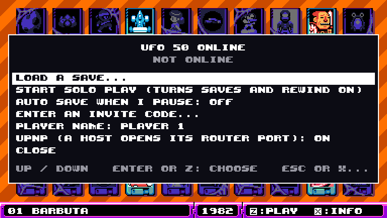
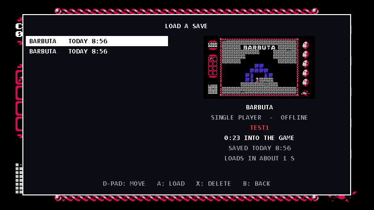

# The Windows version

The same build, for a PC: your modded copy of UFO 50 with this fork's online play, save states and
rewind in place of PFO 50's Steam networking. It plays with the phones: the same lobbies
(oldkid.net rooms, your own network, the relay), the same invite codes, the same online saves.

It is a second game folder next to your Steam installation, not a change to it.

New in v0.4.0, and so far tested on one Windows 10 PC only (two copies of the game side by side,
and one with an Android emulator): see [TESTING.md](TESTING.md) for what was and wasn't tried. If
something doesn't work for you, the log (`%LOCALAPPDATA%\ufo50_online\pfo_online.log`) says most of
what happened; it holds network addresses, so look through it before you post it anywhere.


## What it is and isn't

- **It never talks to Steam.** The folder has no Steam library in it (the build leaves out
  `Steamworks_x64.dll`, `steam_api64.dll` and `steam_appid.txt`, and the game's Steam calls go to
  our `PFO.dll`, which answers them itself, the way the Android build does), so it can't reach your
  Steam account, Steam Cloud, achievements or the Steam version's lobbies. Steam doesn't need to be
  running.
- **It keeps its own saves**, in `%LOCALAPPDATA%\ufo50_online`. The Steam game's are in
  `%LOCALAPPDATA%\ufo50` and are never read or written. To bring your progress along, copy
  `save*.ufo` and `account.ufo` from one folder to the other (copy, don't move).
- **It can't join PFO 50 lobbies on Steam**, and Steam players can't join it. It plays with other
  copies of this build, on Windows or Android, of the same version.
- It contains your copy of the game, like the APK: **keep the folder to yourself.**

## Building it

You need Windows 10 or 11 to build it, and UFO 50 1.9.5 from Steam.
**The folder it makes runs on Windows 7 as well as on 10 and 11, from the same build**: the game's
own `ufo50.exe` (GameMaker's runner) is written for Windows 8 and later — it imports
`PathCchCombine` from a Windows 8 API set and `SetProcessInformation` — so the build rewrites those
two names in its import tables and puts a `PathCch` stand-in beside it, and our `PFO.dll` no longer
needs anything newer than Windows 7 either. On 10/11 the edits take away nothing the game uses: the
patched runner and the untouched one start alike there (there is no DirectX 9 mode, and the runner
draws with Direct3D 11 only, but that is not what the edits touch).

The Steam game itself is not patched and still needs Windows 8 or later: on 7 it stops at once with
"api-ms-win-core-path-l1-1-0.dll is missing", and so does the Vanilla copy (it is the same runner).
Windows 7 needs SP1 with KB2670838 (Direct3D 11) and KB2999226 (the C runtime `PFO.dll` uses), and
how the runner presents frames on 7 is still untried. `-NoWin7` leaves the fixups out, for a folder
meant for 10/11 only. Details and the evidence: [WINDOWS7.md](WINDOWS7.md).

**Quick build** (nothing to install): double-click `build-windows.bat` (or run
`build.bat -Windows`). The first run installs the mods with the UFO 50 Mod Loader, without a window (if
its window does open, click Install, wait until it says it's done, and only then close it; see the
README).

It makes `work\windows\UFO 50 Online`. Start `ufo50.exe` in it. The quick build takes the
netcode from the **Windows kit** (`kit/ufo50-online-windows-v<version>.dll`: PFO 50 with this
fork's netcode, no game data), checked against a fixed checksum, copies your modded copy of the
game without the Steam files, and patches the game data (`scripts/windows_patch.csx`: the Steam
calls go to `PFO.dll`, the save folder's name, the lobby menu).

**Full build** (compiles the netcode): in Git Bash,

```bash
bash build.sh --windows --check   # what it will use
bash build.sh --windows           # PFO.dll from source, then the game folder
bash build.sh --windows --kit     # PFO.dll only, into work/kit/
```

It needs Git for Windows and nothing else: none of the Android tools, no GameMaker, no Visual
Studio. The compiler is [llvm-mingw](https://github.com/mstorsjo/llvm-mingw) (release 20261104),
which the build downloads into `work/llvm-mingw` (190 MB, checked against a fixed checksum). If you
have it already, set `LLVM_MINGW` in `local.env`. The same sources give the same `PFO.dll`, byte for
byte, so a kit can be checked by building it again.

`build.bat -Windows -WinDll <file>` uses a `PFO.dll` of your own (that is what the full build does
with the one it compiled).

## Playing

Keyboard as in the Steam game (Z, X, arrows, Esc pauses) and gamepads as GameMaker finds them.
What the touch overlay is on a phone is here a menu made for a keyboard and a controller, in UFO
50's own menu font (the build exports it from your copy into the game folder as `pfo_font.png`;
without it the menu uses Consolas):



| | keyboard | controller |
|---|---|---|
| open or close the online menu | **F1** | **press both sticks in** |
| move, choose, back | arrows, Enter or Z, Esc or X | D-pad or left stick, A, B |
| delete a save (in the list, twice) | Del | X |
| accept a load another player asked for; rejoin your match when the game offers it | **F2** | from the menu |
| decline the load; forget the match | **F3** | from the menu |
| quick save, quick load (one slot, solo play) | **F5**, **F9** | from the menu |

While the menu is open the game gets no keys and a controller at rest, so nothing you press in the
menu reaches the game. Typing a name or a join code needs the keyboard.

The game's own lobby menu (PLAY ONLINE on the profile screen) hosts and joins as on the phones:
HOST PUBLIC, HOST PRIVATE, JOIN BY CODE and the lobby list. JOIN BY CODE opens a box to type or
paste (Ctrl+V) the host's code.

The **menu** has, depending on where you are:

- your seat and how you're connected (LAN, DIRECT or RELAY), the lobby's invite code and COPY THE
  INVITE CODE
- **SAVE** and **LOAD A SAVE...**: the list of saves, and beside it the chosen save's picture,
  its game, how far in it was made, who was playing and how long it takes to load. A load that
  takes more than about five seconds asks first (LOAD THIS SAVE?).
- **WHO'S PLAYING** (opened by START SOLO PLAY, and in a lobby by WHO'S PLAYING...): every controller
  is a player of its own (the arrow keys, the numpad keys, each pad). Each joins with its A (Z on the
  arrow keys, Del on the numpad, A on a pad), moves with left / right, locks a slot P1-P8 in with A
  and backs out with B (X, End). Enter or START plays (solo) or sends your players' slots (a lobby:
  the host seats everyone).
- **START SOLO PLAY**, which turns saves and rewind on in single player, and then REWIND 15 S /
  30 S / 60 S with the time each will take
- when another player asks to load a save: ACCEPT / DECLINE; after a crash or a closed game:
  REJOIN YOUR MATCH / FORGET THAT MATCH
- AUTO SAVE WHEN I PAUSE (one AUTO save, replaced each time)
- ENTER AN INVITE CODE, PLAYER NAME (empty: this computer's name)
- UPNP: whether hosting asks your router to open the port. The forward is taken back when the game
  closes.



Outside the menu the game shows, as the overlay does on a phone:

- **a box when another player wants to load a save**, with that save's picture, what it is, and
  the seconds left to answer (F2 / F3, or the menu)
- **a loading screen** over the game while a save loads or a rewind runs, with the save's picture
  and how far along it is
- short messages (SAVED, LOADED, P2 SAID NO, YOU ARE P2, WAITING FOR P2, CATCHING UP ...);
  problems in orange. A controller gives a short rumble when a save or load is done.

The first time you host or join, Windows Firewall may ask whether to let `ufo50.exe` through.
Without that, players outside your network reach you through the relay only.

Settings are kept in `%LOCALAPPDATA%\ufo50_online\menu.cfg`, saves in `savestates\` there (each
with its picture, `slotN.png`), and a log in `pfo_online.log`.

Controllers: the menu reads XInput controllers (Xbox ones and those that present themselves as
one), and only with the game version the build was made for (below). Any other controller still
plays the game as GameMaker finds it; the menu is then keyboard only. The controller side was
tested with a stand-in for the controller, not with a real one in hand.

## Snapshots

A *snapshot* is a copy of the running game's whole state in memory (see
[SAVE_STATES.md](SAVE_STATES.md)). The Windows build has them as the Android build does:

- a save you made in this run of the game **loads in about a second** (in the tests: all 50 games
  saved, played on, and loaded back, each load checked against PFO 50's checksums for the next 120
  frames)
- rewind starts from the nearest snapshot and replays only the rest
- in a match, an accepted load **puts the save back on every device within a few frames** and
  the match carries on, on Windows as on the phones

Snapshots live in memory. A save from before the game was last started, or one loaded in the two
seconds after it was made, loads by **replaying the session** from its start at high speed (about
4 seconds per minute played on the test PC), checked the same way. The menu says how long each
load will take.

The snapshots depend on the exact game program: they are made for the `ufo50.exe` of UFO 50 1.9.5
and are checked against it at the start (the log says `snapshots: on` or why not). With **any
other `ufo50.exe` they turn themselves off**, and so does setting `PFO_NO_SNAPSHOTS=1` in the
environment. Without snapshots:

- every load and rewind replays the session
- **a match with that player in it has no snapshots on anyone's device.** The game says so when
  the match starts (command 246), and from then on an online save is a file only, on every device,
  and an accepted load **restarts the match from the save**: every device replays to the save's
  frame and they connect again, the way a save from another match is loaded. It takes longer and
  grows with the length of the match.
- a save from a match whose timeline has snapshot loads in it can't be loaded (the menu says so)
- watching a match that uses saves isn't supported: a device with no seat can't send commands, so
  it can't announce that it has no snapshots, and the players would go on loading by snapshot,
  which it can't follow

## Playing with other versions

**Everyone needs the same version.** v0.3.1 and earlier can't play with v0.4.0, and the lobby keeps
the versions apart: a host refuses a joiner of another version, and a joiner leaves a host of
another version (v0.3.1 hosts let anyone in). The game only says the join failed; the reason is in
`pfo_online.log` ("another version of the build"). Lobbies of another version still show in the
list of oldkid.net rooms, and those on your own network don't.

Everything else is the same code as on Android: the room server, LAN discovery, direct connection
with the relay as fallback, drops and rejoining (a dropped player is waited for up to 90 seconds,
also one who has no player in the current game), the save list, votes on loads.

## Testing it without touching your real game

`tests/win/` has the helpers the Windows build was tested with. They never run the test game in
your own user folders: each test game gets a private `LOCALAPPDATA` under `work/win-sandbox/`, and
every run ends by checking that `%LOCALAPPDATA%\ufo50` (the Steam game's saves) is untouched. See
[TESTING.md](TESTING.md).
